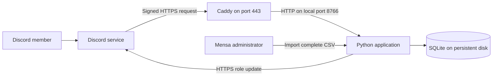

# Install and use Mensa Discord membership

This software connects a Discord account to a Mensa member number.
It gives the `Paid member` role to linked accounts on the current paid-member list.
It removes that role from linked accounts absent from the list.
Discord uses the role to control access to channels.

Use these links to find a procedure:

- [Understand the architecture](#understand-the-architecture)
- [Install on an application host](#install-on-an-application-host)
- [Use the software as a member](#use-the-software-as-a-member)
- [Update the paid-member list](#update-the-paid-member-list)
- [Back up the installation](#back-up-the-installation)
- [Find and correct a problem](#find-and-correct-a-problem)
- [Use the existing test installation](#existing-test-installation)

## Before you start

**The software does not verify ownership of a member number.**
A person can submit another person's number before the correct person submits it.
Duplicate detection does not prevent this first claim.

For a real server, the Mensa administrator must accept this limitation.
If verified ownership is necessary, stop before member registration.
Add verification through the Mensa member system or the member's registered email address first.
This version does not include either method.

The software also has these limits:

- It uses an imported CSV file as the payment record.
- It does not connect to a payment service.
- It does not import existing Discord nicknames or member numbers.
- It controls one Discord server and one role per installation.
- It changes roles only for accounts recorded in its database.
- It does not remove a manually assigned role from an unknown account.
- It does not remove members from the Discord server.
- It does not control access through other roles.

Use a new installation for the real server.
Keep the existing test installation separate.
Do not copy the test credentials or the test database into the real installation.

## Understand the architecture

The Discord server is the community that Discord hosts.
The application host is the computer that runs this Python software.
The application host must remain on and connected to the Internet.

This guide uses one Linux application host with Docker and Caddy.
Caddy is a reverse proxy. It receives HTTPS requests and sends permitted requests to Python.



The components have these functions:

| Component | Function | Location |
| --- | --- | --- |
| Discord application | Identifies the software to Discord. | Discord Developer Portal |
| Bot account | Changes the `Paid member` role. | Real Discord server |
| Caddy | Provides HTTPS and restricts public paths. | Application host |
| FastAPI and Uvicorn | Receive commands and private forms. | One Docker container |
| Background worker | Compares saved links with the paid-member list. | Same Python process |
| SQLite | Stores links, the paid-member list, and pending changes. | Persistent Docker volume |
| Administrator CLI | Imports the paid-member list and checks results. | Inside the container |

Discord sends commands and form submissions to `/interactions` through HTTPS.
The application checks Discord's Ed25519 signature before it accepts each request.
The bot changes roles through the Discord REST API.
There is no Gateway connection or WebSocket connection.
There is no separate member website or OAuth login page.
See [Discord interactions](https://docs.discord.com/developers/interactions/receiving-and-responding).

Run one Python process and one container replica.
The database and the worker are designed for this arrangement.
A separate database server, Redis, and a separate worker service are not necessary.
A platform that stops idle processes cannot run this worker continuously.
A platform that deletes local files cannot keep this database without a persistent disk.

If the application stops, existing Discord roles remain in place.
New registrations and payment changes stop until the application starts again.

## Install on an application host

Complete the sections below in sequence.
Commands run in the project directory on the application host unless a step specifies another location.
Replace example names, IDs, paths, and domains before you run commands.

### 1. Prepare the host

You need these items:

- A Linux host with a persistent disk and administrator access.
- Docker Engine with the Docker Compose plugin.
- Python 3.12 or newer with `venv` and `pip` for initial setup.
- Caddy installed as a host service.
- A domain name, such as `membership.example.org`.
- Permission to manage the real Discord server and install an application.
- The complete current paid-member list.
- A person responsible for imports, backups, and failed updates.

1. Install [Docker Engine and Docker Compose](https://docs.docker.com/engine/install/ubuntu/).
2. Install [Caddy](https://caddyserver.com/docs/install#debian-ubuntu-raspbian).
3. Install Python and its virtual environment package through the Linux package manager.
4. Point the domain's DNS record to the application host.
5. Permit incoming TCP connections on ports 80 and 443.
6. Permit outgoing HTTPS connections to Discord and the certificate service.
7. Keep the application host clock synchronized.
8. Keep port 8766 restricted to the local host.

For Ubuntu 24.04, install the Python packages with this command:

```sh
sudo apt install python3 python3-venv python3-pip
```

Caddy obtains and renews the HTTPS certificate for the configured domain.
The domain must resolve correctly and the required ports must be reachable.
See [Caddy automatic HTTPS](https://caddyserver.com/docs/automatic-https).

### 2. Copy and install the software

The source directory is `0446_Mensa_Discord`.

1. Copy the source files into a new directory on the application host.
2. Exclude `.env`, `data`, `.venv`, `.git`, logs, and cache directories from the copy.
3. Open a terminal in the new directory.
4. Create the Python virtual environment.

```sh
python3 -m venv .venv
```

5. Install the pinned dependencies.

```sh
.venv/bin/python -m pip install -r requirements-lock.txt
```

6. Run the tests.

```sh
.venv/bin/python -m pytest -q
.venv/bin/ruff check mensa tests
```

Expected result: all tests pass and Ruff reports no errors.
The verified test count for this version is 39.

### 3. Replace the test text

The current setup command contains text for the test server.
The production installation needs different text.
These edits affect the new source copy only.

1. Open `mensa/cli.py` in a text editor.
2. Find the channel `topic` value, `Fake membership data only. Private test server.`
3. Replace that value with `Mensa membership access. Use /membership to register.`
4. Find the `panel` dictionary in the `bootstrap` function.
5. Replace only its `content` value with this Python expression.

```python
"content": (
    "**Mensa membership**\n"
    "Click below to link your member number privately. "
    "Each number can be linked to one account. "
    "Use `/membership-status` to check access.\n"
    "This service checks the paid-member list. "
    "It does not verify ownership of the member number. "
    "Contact an administrator to correct a link."
),
```

6. Keep the `allowed_mentions` and `components` entries unchanged.
7. Save the file.
8. Run the tests from section 2 again.

The `configure` command also uses the words "test app" in its prompts.
The supplied token and server ID select the actual installation.

### 4. Create a separate Discord application

1. Open the [Discord Developer Portal](https://discord.com/developers/applications).
2. Create an application for the real server.
3. Open the application's **Bot** page.
4. Generate the bot token.
5. Keep the token private.
6. In Discord, enable **Developer Mode** under **User Settings → Advanced**.
7. Copy the real server's ID from its context menu.
8. Run this command with that server ID.

```sh
.venv/bin/python -m mensa.cli configure --guild REAL_SERVER_ID
```

9. Paste the token into the hidden prompt.
10. Open the installation URL that the command prints.
11. Check that the URL selects the real server.
12. Authorize the installation.

Expected result: the bot appears in the real server's member list.
The command creates `.env` with private file permissions.
It also creates the random administrator token.
Do not create an empty `.env` from `.env.example` before this command.

The installation requests role and channel management permissions.
It also requests channel visibility, message, history, and application-command permissions.
It does not request **Administrator**.
Message Content and Server Members privileged intents are not necessary.

### 5. Create the role and channels

The setup command creates these resources:

- A `Paid member` role without global permissions.
- A `membership-registration` channel available to ordinary members.
- A `paid-members` channel restricted by the new role.
- The `/membership` and `/membership-status` commands.
- A registration message with a button.

The setup command refuses unrelated channels with the same names.
It also refuses multiple `Paid member` roles or an existing role with global permissions.
Do not rename or remove existing community resources without checking their use.
Resolve any name conflict before you continue.

1. Run the setup command with the exact server name.

```sh
.venv/bin/python -m mensa.cli bootstrap --expected-server-name "Exact real server name"
```

2. If the command requests a role move, open **Server Settings → Roles**.
3. Move the bot's role above `Paid member`.
4. Save the role order.
5. Run the setup command again.
6. Open the printed registration URL.
7. Check the registration message and both channel topics.

Expected result: both channels exist and the message contains the production text.

Discord permits a bot to manage roles below its highest role.
See [Discord role permissions](https://docs.discord.com/developers/topics/permissions).

The setup command records resource IDs in `data/discord-setup.json`.
Keep this file with the host configuration.
A later setup run replaces permissions on the channels that it created.
Do not rerun setup after custom permission changes without reviewing those changes.

### 6. Start the application

**Do not use `Start.command` or `Configure.command` for the real server.**
These Mac scripts are for the existing test installation.
`Start.command` can import the fake paid-member list on its first start.

1. Check that `.env` contains the real application ID, server ID, and role ID.
2. Keep `.env` private.

```sh
chmod 600 .env
```

3. Build and start the container.

```sh
docker compose up -d --build
```

4. Check the container state.

```sh
docker compose ps
```

5. Check the local health endpoint.

```sh
curl --fail http://127.0.0.1:8766/healthz
```

Expected response:

```json
{"status":"ok"}
```

The Compose configuration starts one application process.
It stores the database in the `membership-data` Docker volume.
The database path inside the container is `/app/data/membership.sqlite3`.
The host's `data` directory is separate from this Docker volume.

The restart policy restarts a container that exits, unless you stop it.
The health check reports an unhealthy container but does not restart it by itself.
Enable Docker startup when the host starts.

### 7. Configure public HTTPS

This example runs Caddy on the host, outside Docker.
The container publishes port 8766 only on `127.0.0.1`.

1. Open `/etc/caddy/Caddyfile` as an administrator.
2. Add this site configuration with your actual domain.
3. Preserve any existing site configurations.

```caddyfile
membership.example.org {
	@public path /interactions /healthz
	handle @public {
		reverse_proxy 127.0.0.1:8766
	}
	handle {
		respond "Not found" 404
	}
}
```

4. Validate the Caddy configuration.

```sh
sudo caddy validate --config /etc/caddy/Caddyfile
```

5. Reload Caddy.

```sh
sudo systemctl reload caddy
```

6. Check the public health endpoint.

```sh
curl --fail https://membership.example.org/healthz
```

7. Check that the public administrator path returns HTTP 404.

```sh
curl -sS -o /dev/null -w '%{http_code}\n' https://membership.example.org/admin/status
```

Expected results: the health response is `{"status":"ok"}` and the administrator response is `404`.
Public access is limited to the two specified paths.
See [Caddy request handlers](https://caddyserver.com/docs/caddyfile/directives/handle).

### 8. Import the real paid-member list

**An import replaces the complete paid-member list.**
An incomplete file can remove access from linked members who have paid.
The `--apply` command applies the import without another question.

The file must contain exactly one column named `member_number`.
Each number must contain 1 to 20 ASCII digits.
Duplicate numbers are invalid.
Leading zeroes are significant.

Example format only:

```csv
member_number
10001
10002
00123
```

1. Obtain the complete current list from the Mensa administrator.
2. Save the file as UTF-8 CSV.
3. Check that the file preserves leading zeroes.
4. Transfer the file securely to the application host.
5. Copy the file into the container.

```sh
docker compose cp /secure/path/current-paid-members.csv membership:/tmp/current-paid-members.csv
```

6. Give the application user ownership of the copied file.

```sh
docker compose exec --user root membership chown 10001 /tmp/current-paid-members.csv
```

7. Restrict access to the copied file.

```sh
docker compose exec membership chmod 600 /tmp/current-paid-members.csv
```

8. Preview the import.

```sh
docker compose exec membership python -m mensa.cli import-paid /tmp/current-paid-members.csv
```

9. Check the reported member count and changes.
10. Apply the import.

```sh
docker compose exec membership python -m mensa.cli import-paid /tmp/current-paid-members.csv --apply
```

11. Check the application status.

```sh
docker compose exec membership python -m mensa.cli status
```

Expected result: `paid_members` matches the file and `paid_imported_at` is not `null`.
Before registration, `linked_accounts` can be zero.
The application changes no roles before the first import.
The ownership step lets the application read a file copied with private permissions.
See [Docker file copy permissions](https://docs.docker.com/reference/cli/docker/container/cp/).

### 9. Connect Discord to the application

1. Run the connection command with your public domain.

```sh
docker compose exec membership python -m mensa.cli connect https://membership.example.org/interactions
```

2. Check for the `Discord connected to` response.
3. Open the application's **General Information** page in the Developer Portal.
4. Check the **Interactions Endpoint URL**.

Expected result: the saved URL ends with `/interactions` on your domain.
Discord checks the endpoint before it accepts the URL.

The bot can appear offline in the member list.
This software does not open a Gateway connection to publish online presence.
Use the commands and health checks to check operation.

### 10. Check access before general use

Use ordinary Discord accounts for these checks.
The server owner and accounts with **Administrator** can bypass channel restrictions.

1. Ask a member on the paid list to run `/membership`.
2. Have the member submit their own member number.
3. Check that the account receives `Paid member`.
4. Check that the member can open `paid-members`.
5. Ask an authorized tester absent from the list to register a separate test number.
6. Check that the tester cannot open `paid-members`.
7. Check that both accounts can open `membership-registration`.
8. Run `/membership-status` from each account.
9. Check the administrator status for pending changes or errors.
10. Restart the container.
11. Check that both saved links remain available.

```sh
docker compose restart membership
docker compose exec membership python -m mensa.cli status
```

Use the separate test server to check payment removal and restoration with fake lists.
Do not import a partial test list into the real installation.

### 11. Restrict existing channels

The setup command restricts only the new `paid-members` channel.
It does not change existing channels or categories.

For each existing channel that requires paid membership:

1. Open the channel's permission settings.
2. Deny **View Channel** for `@everyone`.
3. Allow **View Channel** for `Paid member`.
4. Review permissions for all other roles and individual members.
5. Remove other access grants that conflict with the membership policy.
6. Check the channel with an ordinary unpaid account.
7. Check the channel with an ordinary paid account.

If permissions come from a category, change and test the category permissions instead.
Keep the registration channel available to unpaid members.
Keep required moderator access separate from membership access.

## Use the software as a member

1. Open `membership-registration`.
2. Click **Link Mensa membership**, or run `/membership`.
3. Enter your own member number in the private form.
4. Submit the form.
5. Run `/membership-status` to check the result.

The account link uses the unique Discord user ID.
A change to the Discord display name does not change that link.
The application sends registration and status replies privately.
A number absent from the paid list can be linked without paid access.
An administrator must remove an incorrect link before the member can change it.

## Update the paid-member list

1. Obtain a new complete paid-member list.
2. Repeat section 8 with the new file.
3. Check that `pending` and `errors` return to zero.

The import command requests role updates immediately.
The worker also retries pending changes at intervals of up to 30 seconds.
A full check of saved accounts starts every five minutes by default.
Discord rate limits and errors can delay completion.

The software does not detect later payments without another import.
Choose an import frequency that matches the required access delay.
Automated exports and scheduled imports require a separate integration.

To request a full check now, run this command:

```sh
docker compose exec membership python -m mensa.cli sync
```

For an intentionally empty paid-member list, add `--allow-empty` to the apply command.
This can remove paid access from every linked account.

## Correct an account link

1. Verify the member's identity through the Mensa administration process.
2. Copy the member's Discord user ID.
3. Remove the incorrect link with that ID.

```sh
docker compose exec membership python -m mensa.cli unlink DISCORD_USER_ID
```

4. Check the administrator status.
5. Ask the member to run `/membership` again.

The command releases the number and requests removal of the paid role.

## Check operation

1. Check the application status regularly.

```sh
docker compose exec membership python -m mensa.cli status
```

2. Inspect application logs if errors continue.

```sh
docker compose logs --tail 100 membership
```

3. Monitor the public health endpoint for loss of service.
4. Check the date of the last paid-member import.
5. Check available disk space and backup results.

A successful health response checks the database and the background task.
It does not prove that Discord accepts role updates.
Use the administrator status and an ordinary account to check those updates.

## Back up the installation

The database contains member numbers and Discord user IDs.
Protect the database and its backups as membership records.

1. Create a private backup directory on the application host.

```sh
mkdir -p backups
chmod 700 backups
```

2. Choose a new filename for each backup.
3. Create the database backup inside the container.

```sh
docker compose exec membership python -m mensa.cli backup /app/data/backup-2026-11-05.sqlite3
```

4. Copy the backup to the host.

```sh
docker compose cp membership:/app/data/backup-2026-11-05.sqlite3 backups/backup-2026-11-05.sqlite3
chmod 600 backups/backup-2026-11-05.sqlite3
```

5. Store a protected copy outside the application host.
6. Back up `.env`, `data/discord-setup.json`, and the production source edits separately.
7. Back up the Caddy configuration and the current paid-member file.
8. Test database recovery on an isolated installation.

The backup command includes committed SQLite data while the application runs.
A plain copy of an active database file can omit data from its journal.
The host Python CLI uses a different database path from the container.
Use the container command above for production backups.

For recovery, stop the application before replacing the database.
Preserve the current volume before you restore a backup.
Restore ownership to the container user, UID `10001`.
Remove obsolete SQLite journal files only after preserving the stopped database.
A restored database can contain an old paid-member list.
Validate the restored list before the worker can connect to Discord.

Do not run `docker compose down -v` during normal operation.
The `-v` option removes the persistent database volume.

## Update the software

1. Test the new version in the separate test installation.
2. Back up the production installation.
3. Stop the production container.

```sh
docker compose stop membership
```

4. Replace the source files with the tested version.
5. Preserve `.env`, `data/discord-setup.json`, and the Docker volume.
6. Preserve the production message text from section 3.
7. Build and start the new container.

```sh
docker compose up -d --build
```

8. Repeat the health and account checks.

The current Compose configuration reuses the existing database volume.
Use the same project directory and Compose project name.
A different project name can select a new, empty volume.
Database compatibility must be checked before a future software update.

## Find and correct a problem

| Problem | Check or corrective action |
| --- | --- |
| `Move the app's role above Paid member` | Move the bot role above `Paid member`. Run the failed command again. |
| `Server name does not match` | Check the server ID and exact `--expected-server-name` value. |
| Existing channel refused | Resolve the name conflict. Do not remove the setup ownership check. |
| Token belongs to a different application | Use a clean production directory and the correct token. |
| Discord returns HTTP 401 | Check the bot token. Replace an expired or revoked token. |
| Discord returns HTTP 403 | Check **Manage Roles** and the role order. |
| Discord returns HTTP 404 during a role update | Check that the account remains in the configured server. |
| Discord rejects the endpoint | Check HTTPS, the public key, the host clock, and the exact endpoint path. |
| Commands do not appear | Check app installation, setup completion, and **Use Application Commands** permissions. |
| Link waits for a paid list | Import the first complete paid-member list. |
| A member still has access after role removal | Check other role grants, member overrides, and administrator access. |
| A paid member has no access | Check the imported number, leading zeroes, pending changes, and channel permissions. |
| A number is already linked | Verify ownership before an administrator removes the existing link. |
| The container is unhealthy | Inspect logs and disk space. Correct the cause before restarting. |
| `.env` changes have no effect | Recreate the container with `docker compose up -d --force-recreate membership`. |

## Configuration reference

The `configure` and `bootstrap` commands write `.env` on the host.
Compose passes those values to the container when it creates the container.

| Setting | Purpose |
| --- | --- |
| `DISCORD_APPLICATION_ID` | Selects the Discord application. |
| `DISCORD_PUBLIC_KEY` | Checks the signatures of Discord requests. |
| `DISCORD_BOT_TOKEN` | Authorizes role updates. Keep this value secret. |
| `DISCORD_GUILD_ID` | Selects the Discord server. A guild is a Discord server. |
| `DISCORD_PAID_ROLE_ID` | Selects the role controlled by this installation. |
| `ADMIN_TOKEN` | Protects administrator HTTP requests. Keep this value secret. |
| `DATABASE_PATH` | Selects the SQLite file. Compose sets `/app/data/membership.sqlite3`. |
| `APP_URL` | Selects the local administrator API address. Default: `http://127.0.0.1:8766`. |
| `RECONCILE_SECONDS` | Sets the interval between full checks. Default: `300`. Minimum: `5`. |

The Python dependencies are FastAPI, Uvicorn, HTTPX, PyNaCl, and python-dotenv.
The test tools are pytest and Ruff.
`requirements-lock.txt` contains the pinned versions.

## Existing test installation

The Mac launcher expects a configured test server named `Mensa Membership Test`.
Use `Configure.command` to enter that server's ID and the bot token.
Install the app with the URL that the command prints.
Install ngrok and configure its account before you start the launcher.

To use the existing test installation:

1. Open `Start.command` on the Mac.
2. Keep the terminal window open.
3. Keep the Mac awake.
4. Open the registration channel.
5. Use fake member numbers only.

The launcher starts Python and an ngrok HTTPS tunnel.
It connects Discord to the tunnel URL automatically.
It imports the fake list only when no paid-member list exists.
The application stops when you stop the launcher.

Live checks on November 5, 2026 verified registration and private status replies.
They also verified role assignment, removal, and restoration for the signed-in account.
Discord's role preview verified channel visibility.
A second ordinary account has not yet completed the live acceptance test.
The Linux Docker deployment has not yet been tested on a production host.
